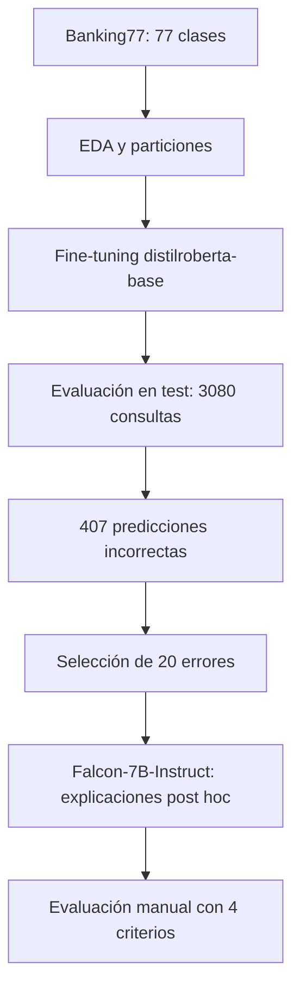

  

  
  
  
  

# Clasificación de intenciones con Transformers y análisis crítico de errores con LLM

**Caso de estudio académico individual · Sistemas Cognitivos Artificiales · Maestría en Inteligencia Artificial**

> **Pregunta central:** ¿puede un modelo generativo explicar de forma fiable los errores de un clasificador de intenciones bancarias? El experimento muestra por qué **coherencia lingüística ≠ explicación causal**.

## 🎯 Problema

Los asistentes bancarios necesitan distinguir entre **77 intenciones** expresadas en consultas breves y con vocabulario solapado. Además de medir el acierto del clasificador, el experimento analiza la utilidad —y los límites— de las explicaciones generadas por un segundo modelo.

Se utiliza **[Banking77](https://huggingface.co/datasets/PolyAI/banking77)**: 13,083 consultas en inglés, con 10,003 muestras de entrenamiento y 3,080 de prueba.

## 🔄 Flujo experimental

## 📊 Resultados documentados

### Clasificador DistilRoBERTa

| Métrica (test, n = 3,080) | Resultado |
| :--- | ---: |
| **Accuracy** | **86.79 %** |
| **F1 macro** | **86.02 %** |
| Precisión macro | 88.38 % |
| Recall macro | 86.79 % |
| Predicciones correctas | 2,673 |
| Predicciones incorrectas | 407 |

Configuración reportada: `distilroberta-base`, 77 clases, tasa de aprendizaje de `2e-5`, tres épocas y selección del mejor modelo mediante **F1 macro** sobre validación. El conjunto de prueba se reservó para la evaluación final.

### Evaluación manual de explicaciones de Falcon-7B-Instruct

| Criterio (n = 20) | Casos que cumplen | Porcentaje |
| :--- | ---: | ---: |
| Coherencia | 20 | 100 % |
| Fundamentación en la consulta | 12 | 60 % |
| Explica la confusión | 6 | **30 %** |
| Cumplimiento de formato | 18 | 90 % |

**Interpretación:** una respuesta puede resultar coherente, pero introducir información no sustentada o no explicar realmente el error. Falcon solo recibió la consulta, la etiqueta correcta y la predicha: **no tuvo acceso a los pesos, logits ni estados internos del clasificador**. Sus textos son interpretaciones *post hoc*, no explicaciones causales verificadas.

Los resultados corresponden a las **salidas y conclusiones del notebook académico original**, no a una reejecución independiente. La revisión manual de 20 casos es ilustrativa; no basta para generalizar estadísticamente sobre los 407 errores.

## 🧪 Cómo explorar el experimento

1. Consulta el notebook experimental en la carpeta `notebooks/` **(pendiente de incorporar al repositorio)**.
2. Revisa [metodología y límites](docs/methodology-and-limitations.md).
3. Ejecuta en **Google Colab con GPU** y comprueba versiones y disponibilidad de los modelos. **No** es una aplicación ligera ni un servicio listo para producción.

El notebook fuente incluye instrucciones de instalación y descarga datos/modelos desde Hugging Face. El entrenamiento y Falcon-7B-Instruct requieren recursos GPU importantes; en el entorno registrado se utilizó cuantización de 4 bits para Falcon.

> **Nota de reproducibilidad:** los paquetes no están completamente fijados a versiones; Hugging Face, PyTorch y CUDA pueden cambiar. Para reproducibilidad estricta se necesita registrar un entorno congelado y volver a ejecutar el experimento de principio a fin.

## 🧭 Qué demuestra

- Preparación y análisis de datos de texto multiclase.
- Entrenamiento y evaluación de un Transformer discriminativo.
- Análisis sistemático de predicciones incorrectas.
- Diseño y calibración de *prompts* para un LLM.
- Evaluación humana de fundamentación, coherencia y utilidad de explicaciones.
- Comunicación explícita de riesgos y limitaciones de la IA generativa.

## 🔒 Uso responsable

Es un experimento **educativo**, no un sistema bancario real. No contiene datos de clientes ni credenciales. Se publican el método y el código, no pesos de modelos derivados ni copias del dataset. Antes de una reutilización comercial deben comprobarse las licencias del dataset, modelos y dependencias.

## 📚 Documentación

- [Metodología, entorno, resultados y limitaciones](docs/methodology-and-limitations.md)
- Notebook experimental: **pendiente de incorporar**

---

<strong>Evaluar la IA implica cuestionar también las explicaciones que genera.</strong>

Autor: <a href="https://github.com/isaiassolis">Isaías Solís</a>
