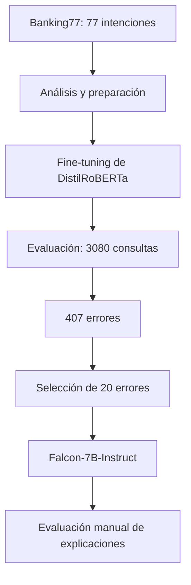

  

  
  
  
  

# Clasificación de intenciones con Transformers y análisis de errores mediante LLM

**Inteligencia artificial aplicada · Procesamiento de lenguaje natural · Evaluación crítica de explicaciones**

Desarrollé este proyecto académico en la asignatura **Sistemas Cognitivos Artificiales** de la **Maestría en Inteligencia Artificial** para estudiar dos problemas relacionados: **clasificar correctamente las consultas bancarias** y determinar hasta qué punto un modelo de lenguaje puede explicar los errores de un clasificador.

Entrené un modelo **DistilRoBERTa** para reconocer **77 intenciones bancarias** y después utilicé **Falcon-7B-Instruct** para analizar una selección de predicciones incorrectas.

El experimento dejó una conclusión importante: **una explicación redactada de manera convincente no necesariamente describe por qué un modelo se equivocó**.

## El desafío

En atención bancaria, preguntas breves pueden expresar necesidades distintas utilizando palabras similares. Un clasificador debe diferenciar entre consultas sobre transferencias, tarjetas, pagos, cuentas y otros servicios.

Además de medir la clasificación, quise examinar qué sucede cuando pedimos a un **LLM** que explique un error de otro modelo.

Para ello utilicé [Banking77](https://huggingface.co/datasets/PolyAI/banking77), un conjunto de **13,083 consultas en inglés**, organizadas en **77 categorías**.

## Cómo desarrollé el experimento

El trabajo tuvo dos componentes:

1. **Clasificación de intenciones:** preparé los datos, realicé el *fine-tuning* de `distilroberta-base` y evalué su desempeño en consultas reservadas.
2. **Análisis de errores con IA generativa:** seleccioné **20 predicciones incorrectas**, solicité explicaciones a Falcon-7B-Instruct y las revisé mediante cuatro criterios.

## Resultados del clasificador

Utilicé **10,003 consultas** del conjunto de entrenamiento, de las cuales **9,002** se destinaron al ajuste del modelo y **1,001** a validación. La evaluación final se realizó con **3,080 consultas** del conjunto de prueba.

| Métrica | Resultado |
| :--- | ---: |
| **Exactitud (accuracy)** | **86.79 %** |
| **F1 macro** | **86.02 %** |
| Precisión macro | 88.38 % |
| Recall macro | 86.79 % |
| Predicciones correctas | 2,673 |
| Predicciones incorrectas | 407 |

La configuración registrada utilizó **tres épocas**, una tasa de aprendizaje de `2e-5` y selección del mejor modelo mediante **F1 macro de validación**.

## ¿Qué tan útiles fueron las explicaciones del LLM?

Después de identificar los errores del clasificador, seleccioné **20 casos** y utilicé **Falcon-7B-Instruct** para generar explicaciones basadas en la consulta, la intención correcta y la intención predicha.

Evalué manualmente cuatro aspectos:

| Criterio | Casos satisfactorios | Resultado |
| :--- | ---: | ---: |
| **Coherencia lingüística** | 20 de 20 | **100 %** |
| **Fundamentación en la consulta** | 12 de 20 | **60 %** |
| **Explicación de la confusión** | 6 de 20 | **30 %** |
| **Cumplimiento del formato** | 18 de 20 | **90 %** |

### El hallazgo principal

Aunque **todas las explicaciones evaluadas eran lingüísticamente coherentes**, solo **6 de las 20** explicaban de manera satisfactoria la confusión entre la etiqueta correcta y la predicha.

Falcon no tenía acceso a los pesos, las activaciones ni las decisiones internas de DistilRoBERTa. Por eso, sus respuestas son **interpretaciones posteriores (*post hoc*)**, no explicaciones causales del funcionamiento del clasificador.

La muestra de 20 errores permitió explorar el problema, pero no equivale a una medición representativa de los **407 fallos**.

## Tecnologías y herramientas

| Área | Herramientas |
| --- | --- |
| **Lenguaje** | Python |
| **Clasificación NLP** | DistilRoBERTa, Hugging Face Transformers |
| **Experimentación** | PyTorch, Google Colab |
| **Conjunto de datos** | Banking77 |
| **Explicaciones generativas** | Falcon-7B-Instruct |
| **Optimización de memoria** | Cuantización de 4 bits para Falcon |
| **Evaluación** | Accuracy, precisión, recall, F1 macro y revisión manual |

El experimento se preparó para ejecutarse en **Google Colab con GPU**; el entorno registrado utilizó una **NVIDIA Tesla T4**.

## Mi participación y aprendizajes

Desarrollé el flujo experimental, desde el análisis y preparación de las consultas hasta el ajuste del clasificador, la revisión de errores y la evaluación de explicaciones generadas mediante LLM.

Este proyecto fortaleció mi experiencia en **procesamiento de lenguaje natural, modelos Transformer, experimentación con redes neuronales y evaluación crítica de sistemas generativos**.

También me permitió estudiar un problema especialmente relevante para la **IA explicable**: distinguir entre una explicación plausible y una explicación fundamentada en el comportamiento real del sistema.

## Notebook y documentación

- [Explorar el notebook experimental](banking77_falcon_experiment.ipynb).
- [Consultar la metodología, los resultados y sus limitaciones](docs/methodology-and-limitations.md).

El notebook contiene el código del experimento y puede requerir ajustes de dependencias y recursos GPU para ejecutarse nuevamente. Los resultados anteriores provienen de la ejecución académica original.

## Sobre el proyecto

Es un trabajo **académico y experimental**, no un sistema bancario en producción. Se comparte el código del notebook y la metodología; los datos se obtienen desde el conjunto público de Banking77 y no se distribuyen pesos entrenados ni información bancaria de clientes.

---

<strong>Una explicación convincente no siempre es una explicación correcta.</strong>

<a href="https://github.com/isaiassolis">Isaías Solís · Portafolio profesional</a>

